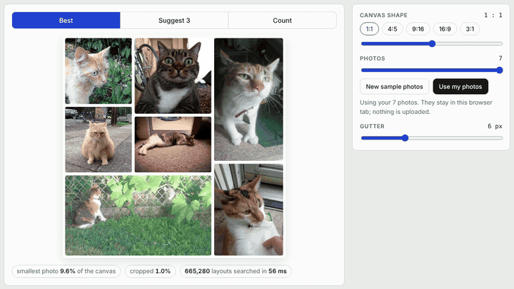
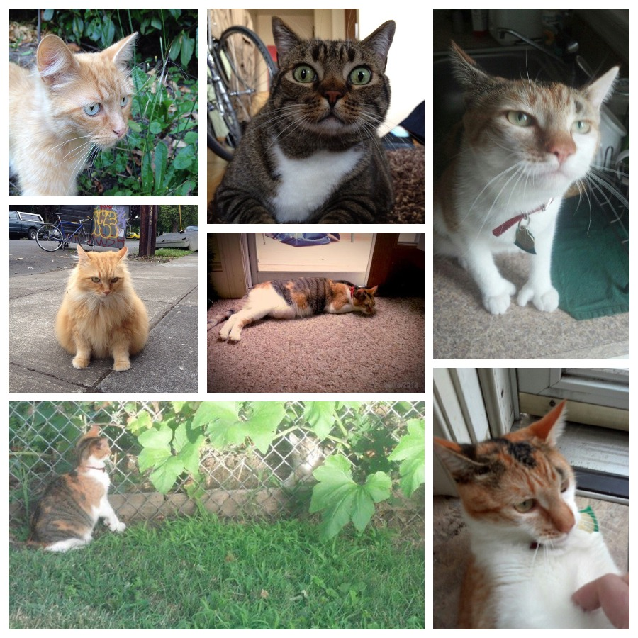
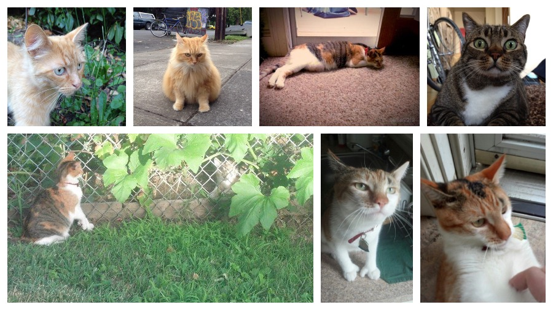
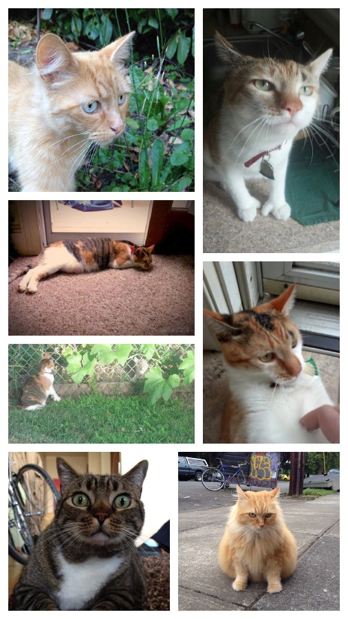
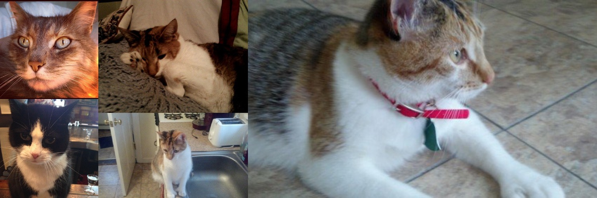
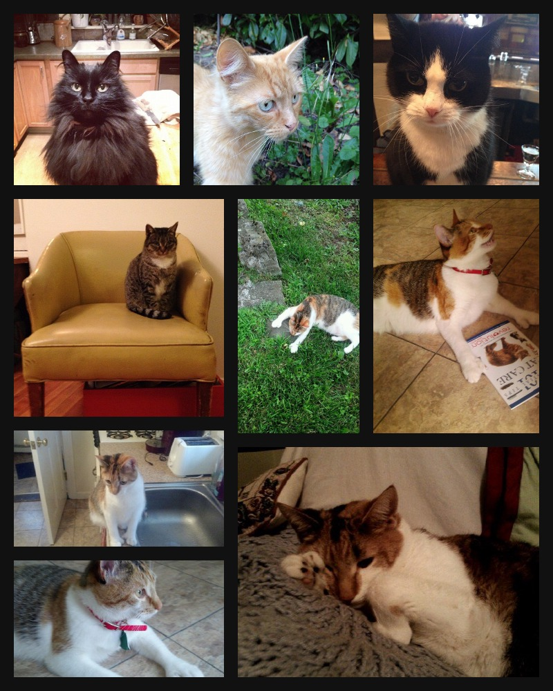
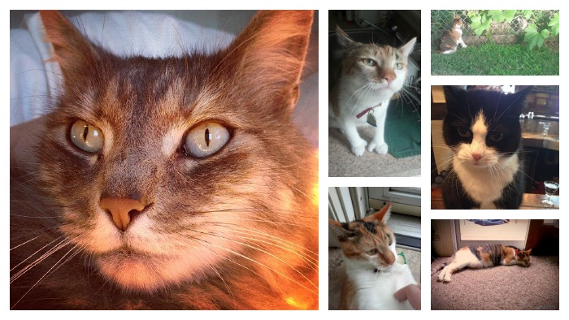
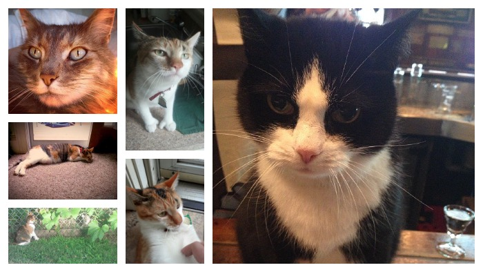
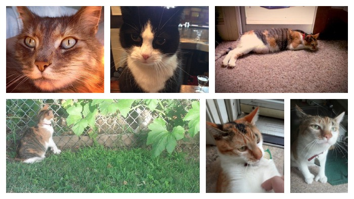

# collage

Arrange photos into a gap-free collage of any shape, from the command line or in your browser.

**[Try it in your browser](https://vinodhalaharvi.github.io/collage/)**, no install needed. Your photos never leave the page.



```sh
brew install vinodhalaharvi/tap/collage
```



```sh
collage cats/ginger.jpg cats/tabby.jpg cats/garden.jpg cats/curious.jpg \
        cats/rug.jpg cats/calico.jpg cats/lion.jpg
```

Every arrangement is searched, not guessed. With 9 photos there are over 500 million guillotine layouts (every split is a straight cut through the whole region). `collage` finds the one where the smallest photo is as large as possible and the crop to your canvas is as small as possible, in under a second.

## Examples

All photos are from [max-mapper/cats](https://github.com/max-mapper/cats) ([credits](docs/cats/CREDITS.md)); try them yourself from the `docs` folder.

### Same photos, any shape

The seven cats above, re-laid for a 16:9 slide and a 9:16 story. Only `-ratio` changes; the layout is solved again from scratch.

| `-ratio landscape` | `-ratio story` |
|---|---|
|  |  |

### A banner with no gutter

```sh
collage -ratio banner -gutter 0 -size 1500 -o banner.jpg \
        cats/amber.jpg cats/collar.jpg cats/nap.jpg cats/tux.jpg cats/sink.jpg
```



### Nine photos on a dark background

```sh
collage -ratio portrait -gutter 20 -bg "#111111" -o dark.jpg \
        cats/floof.jpg cats/armchair.jpg cats/lawn.jpg cats/tiles.jpg cats/sink.jpg \
        cats/nap.jpg cats/tux.jpg cats/collar.jpg cats/ginger.jpg
```



518,918,400 layouts searched in under a second.

### Let it suggest

`-suggest 3` writes the three best layouts that look different at a glance: a different hero photo or a different main split.

```sh
collage -ratio 16:9 -suggest 3 -o pick.jpg \
        cats/amber.jpg cats/garden.jpg cats/curious.jpg cats/rug.jpg cats/calico.jpg cats/tux.jpg
```

| `pick-1.jpg` | `pick-2.jpg` | `pick-3.jpg` |
|---|---|---|
|  |  |  |

### In the browser

```sh
collage serve
```

Opens an editor where dragging the canvas shape re-lays the collage instantly, with Best, Suggest 3 and Count modes. The solver runs in the page as WebAssembly, so nothing is uploaded. The same editor is hosted at [vinodhalaharvi.github.io/collage](https://vinodhalaharvi.github.io/collage/).

## Flags

| Flag | Meaning | Default |
|---|---|---|
| `-o FILE` | output, `.jpg` or `.png` | `collage.jpg` |
| `-ratio R` | `16:9`, `1.5`, or `square`, `portrait` (4:5), `story` (9:16), `landscape` (16:9), `banner` (3:1) | `square` |
| `-size PX` | longer side of the canvas | `2400` |
| `-gutter PX` | space between photos | `12` |
| `-bg COLOR` | background `#rrggbb` | `#ffffff` |
| `-suggest N` | write N structurally different layouts | `1` |

Up to 10 photos. JPEG, PNG and GIF work everywhere. On macOS, HEIC (the iPhone default) and WebP are converted on the fly with the built-in `sips`. Phone photos are turned upright from their EXIF orientation.

## How it works

The solver is one dynamic program built on [dyna](https://github.com/vinodhalaharvi/dyna), a small Go library for dynamic programs written as recursion schemes:

```
F X   = Leaf photo | Split cut X X                 one layout step (a functor)
coalg : {photos} → [Leaf p | Split H A B | Split V A B]   how a problem shrinks
alg   : F T → T,  bilinear over (T, ⊕)              how answers combine (a semiring)
dyna  = ⊕ ∘ map(alg ∘ F dyna) ∘ coalg, memoised     dynamic programming
```

Side-by-side photos have aspect ratios that add (a = a₁ + a₂); stacked photos add as reciprocals (1/a = 1/a₁ + 1/a₂). The state is `(subset of photos, aspect bucket)`, so the answer is indexed by aspect ratio and resizing the canvas is a lookup, not a re-solve.

The algebra is built from parts:

- `Count` (+, ×) counts layouts.
- `TopK₃` (max, min) keeps the three layouts whose smallest photo is largest.
- `Product` runs both in one pass; `Lift` (the monoid-semiring construction) grades them by aspect ratio.

The DP is only correct if the algebra obeys the semiring laws, distributivity above all. `collage laws` checks them with random trials and compares the DP against brute force:

```
$ collage laws
  Count × TopK₃
    distributes over ⊕     holds
    ...
    6 photos   30,240 layouts   608 steps over 63 subproblems  equal
```

Aspect ratios are bucketed (64 buckets over 1:12 to 12:1), so the search is exact for the bucketed problem; the chosen layout is then re-measured with each photo's true shape.

## Building from source

```sh
go build ./cmd/collage          # web/engine.wasm is committed
make wasm                       # rebuild the browser engine after changing engine/
make test
```

## License

Code: MIT. Example photos in `docs/cats`: BSD, see [credits](docs/cats/CREDITS.md).
